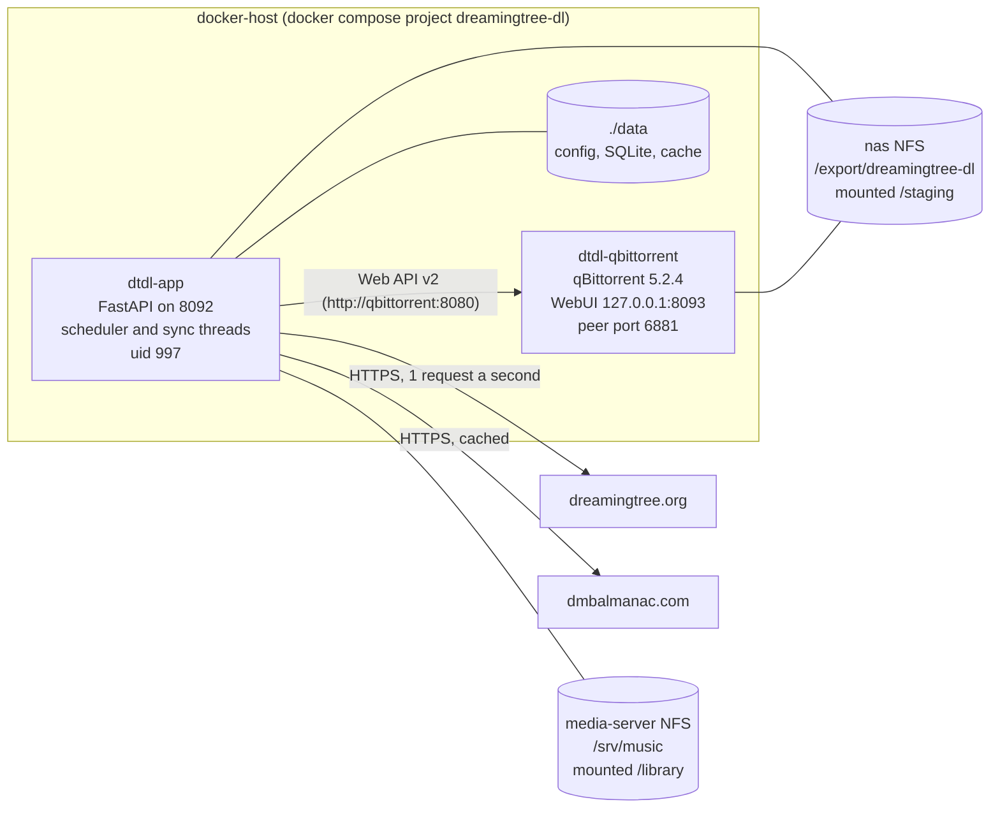
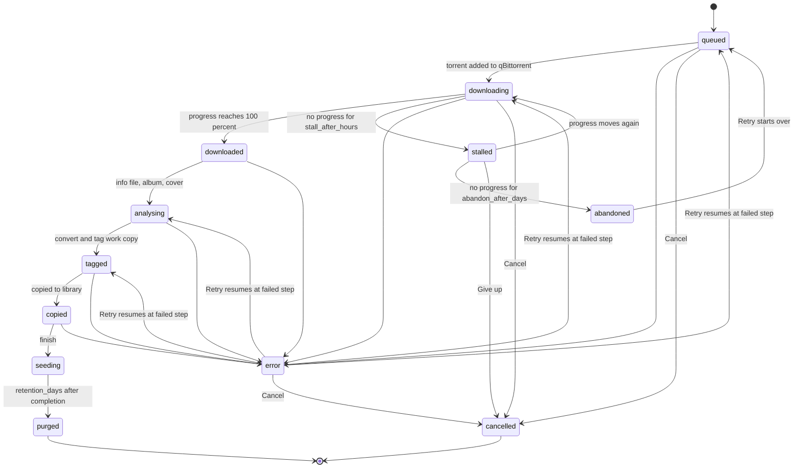

# Architecture

How dreamingtree-dl is put together, and why. For config keys see [CONFIG.md](CONFIG.md). For the tagging rules see [TAGGING.md](TAGGING.md).

## Containers and hosts



- **`dtdl-app`** (`docker/Dockerfile`, service `app`): the web UI, the API, the pipeline and the background threads. Image is `python:3.11-slim` plus `ffmpeg`, `flac` and `ca-certificates`. Runs as `997:997` with group `1000` added, so it can write `data/` on the host.
- **`dtdl-qbittorrent`** (service `qbittorrent`): the linuxserver qBittorrent image, pinned in `docker/docker-compose.yml`. Its WebUI is published only on `127.0.0.1:8093`, for debugging. Peer traffic uses port 6881 TCP and UDP, published on all host interfaces.
- The two containers share the `dtdl_staging` volume. The app starts after qBittorrent (`depends_on`), but the app does not restart qBittorrent.

## Volumes

| Volume or bind | Source | Mounted at | Used by | Notes |
|---|---|---|---|---|
| `dtdl_staging` | NFS v4, `<nas-ip>:/export/dreamingtree-dl` (nas) | `/staging` in both containers | torrents and work copies | `torrents/<torrent folder>` is qBittorrent's save path. `work/<job id>` holds the working copies. |
| `dtdl_library` | NFS v4, `<media-server-ip>:/srv/music` (media-server) | `/library` in the app | the Plex music library | App only. Only the app writes here. |
| `../data` (bind) | `~/dreamingtree-dl/data` | `/app/data` in the app, `/config` in qBittorrent | config, database, cookies, caches | See below. |

Both NFS volumes use `rw,nfsvers=4,soft,timeo=100,retrans=2`. `soft` means a dead NFS server produces I/O errors instead of hanging a process, so a job can fail with an I/O error rather than block. `preflight.sh` checks that both volumes are really NFS mounts inside a container and that uid 997 can write.

### The data folder

| Path | What it is | Can be deleted? |
|---|---|---|
| `config.json` | All settings, including the dreamingtree and qBittorrent passwords. Mode 660. | No. Back it up. See [CONFIG.md](CONFIG.md#secrets). |
| `dtdl.sqlite3` (+ `-wal`, `-shm`) | Jobs, job event log, listing cache, meta keys. | Not without losing job history. Stop the app before copying it. |
| `dreamingtree.cookies` | Site session cookies, written by the app with mode 600. | Yes. The app logs in again. |
| `library_index.json` | Cached index of the media-server library, so restarts show the In library column at once. | Yes. Rebuilt by the scan. |
| `cache/art/dmbalmanac/` | Cached dmbalmanac listings, media pages and posters. Created on first lookup. | Yes. Refetched, at 1 request a second. |
| `qbittorrent/` | qBittorrent's config, its `.torrent` backups and fast-resume data, and the GeoIP database. | Not while downloads are active. Deleting it forgets every torrent. |

The torrent data itself lives on nas, not in `data/`. The library copies live on media-server.

Logs are not written to files. They go to the container's stdout, so use `docker logs dtdl-app`.

## Job state machine

Every download is a row in the `jobs` table. The state moves forward through the pipeline, and the scheduler and the per-request threads advance it. Each step is idempotent, so a crash or a retry does not duplicate or corrupt work.



The diagram shows the main transitions. The `error` retry can resume at any step that failed. Those are `queued`, `downloading`, `downloaded`, `analysing`, `tagged` or `copied`. The diagram shows four of them.

| State | Meaning | What happens next | Shown in UI as |
|---|---|---|---|
| `queued` | Created. The `.torrent` is not yet added to qBittorrent. | `_start` downloads the `.torrent` and adds it to qBittorrent. | pending |
| `downloading` | In qBittorrent and making progress. | Polled every scheduler tick (30 s). At 100 percent it moves to `downloaded` and records `completed_at`. | running |
| `stalled` | No progress for `stall_after_hours` (default 24). Still polled. | Returns to `downloading` when progress moves. Becomes `abandoned` after `abandon_after_days` (default 14). The owner can Give up. | pending |
| `abandoned` | Gave up after `abandon_after_days`. The torrent and partial data were removed. | Only Retry, which queues the job again from scratch. | failed |
| `downloaded` | Download complete. Nothing has been changed on disk yet. | `_analyse` reads the info file and computes the album and cover. | running |
| `analysing` | Album name and cover are known. Work directory `work/<id>/` holds `cover.jpg`. | `_tag` converts and tags audio into the work directory. | running |
| `tagged` | Work directory holds tagged FLAC files named `NN Title.flac`. | `_publish` copies them and the info file to the library, then runs the post-publish command. | running |
| `copied` | Library copy is in place. | `_finish` moves to `seeding`. | running |
| `seeding` | The torrent keeps seeding from staging. The library copy is independent. | Purged once `completed_at` is older than `retention_days`. | success |
| `purged` | The torrent and its data were removed from qBittorrent and staging. | Terminal. | grey "cancelled" style |
| `error` | A step raised. `error_detail` holds `[<step>] message`. | Retry resumes the failed step. | failed |
| `cancelled` | Stopped by you. | Terminal. The job is no longer marked in Browse, so the show can be queued again. | grey |

Two details matter in practice:

- qBittorrent reporting `error` or `missingFiles` for a torrent makes the poll step fail, so the job goes to `error` with that state in its detail.
- A cancelled job whose download had already finished leaves its torrent seeding in qBittorrent. Only purge removes torrents, and purge looks at `seeding` jobs only. See [OPERATIONS.md](OPERATIONS.md#known-gaps).

## Data flow for one show

Take `dmb2025-07-12.ca-11.flac16` queued to the "Dave Matthews Band" destination.

1. **Queue.** `POST /api/queue` creates the job (`queued`). A thread runs `advance` for it, so the request returns at once.
2. **Start.** The app downloads the `.torrent` from dreamingtree, using the site's `authkey` and `torrent_pass`. It adds it to qBittorrent with save path `/staging/torrents`, category `dreamingtree-dl`, and tag `dtdl-<job id>`. It records the infohash. The torrent data lands in `nas:/export/dreamingtree-dl/torrents/dmb2025-07-12.ca-11.flac16/`.
3. **Download.** The scheduler polls qBittorrent every 30 seconds. At 100 percent the job becomes `downloaded`.
4. **Analyse.** The app finds the info `.txt` in the torrent folder. It parses the setlist, source and location, then builds the album name (`2025-07-12: Mountain View, CA`). It chooses a cover: an image in the torrent, else the dmbalmanac poster, else none. The cover is written to `work/<id>/cover.jpg`.
5. **Tag.** Audio files are staged in `work/<id>/_t/`. SHN, APE and WAV files are converted to FLAC with ffmpeg, keeping sample rate and bit depth. FLAC files are copied. The tagger writes the tags and embeds the cover. Files are then renamed `01 Title.flac`, or `d2-01 Title.flac` for multi-disc shows. Warnings are stored on the job.
6. **Publish.** The target folder is `destination path` mapped through `library_mounts`, plus the folder template. For this show that is `/library/DMB_Live/dmb2025-07-12.ca-11.flac16`, which is `/srv/music/DMB_Live/...` on media-server. The app copies the work files and the info `.txt` into a temporary folder next to the target, then renames it into place. It refuses to write into a non-empty folder. The work directory is deleted and the post-publish command runs.
7. **Seed.** The job moves to `seeding`. qBittorrent keeps seeding from staging, unchanged.
8. **Purge.** Once `completed_at` is more than `retention_days` (default 90) old, the daily purge removes the torrent and its data from qBittorrent and staging. The library copy stays.

### Why the torrent data is never modified

The torrent is seeding data. Its pieces are verified against hashes in the `.torrent` file. If a file in the torrent folder changes, qBittorrent sends bad pieces to peers, and peers drop the connection. So nothing touches the torrent folder. Conversion, tagging and renaming happen only on copies in `work/`. The library copy is a separate set of files. The cost is double disk use on nas until purge.

## Modules

```
app/
  server.py        FastAPI routes; picks FakeBackend (DTDL_FAKE=1) or LiveBackend
  backend.py       Backend protocol, FakeBackend demo data, settings merge and redaction
  live.py          LiveBackend: wires the pipeline, scheduler, listing cache, library index
  pipeline.py      the state machine: queue, advance, retry, cancel, stall check, publish, purge
  scheduler.py     background thread: tick every 30 s, daily purge check
  db.py            SQLite schema and repository (jobs, events, seen_torrents, meta)
  models.py        shared dataclasses and the JobState enum
  config.py        Config (pydantic), load and save, library_mounts path mapping
  dreamingtree.py  site client: login, listing pages, detail, .torrent download; 1 request a second
  names.py         torrent release name -> artist code, date, source tokens, format
  infofile.py      info .txt -> venue, city, region, country, date, lineage, setlist
  sources.py       source suffix: '', siriusxm, sbd, fm, webcast, matrix, tv
  albumname.py     ALBUM string builder and the US, Canada, UK and country tables
  art.py           cover priority: torrent image, dmbalmanac poster (cached), none
  tagger.py        FLAC tags and embedded cover (mutagen)
  convert.py       ffmpeg: SHN, APE, WAV to FLAC
  qbit.py          qBittorrent Web API v2 client; infohash from the .torrent bytes; app prefs
  library.py       index of media-server show folders for the In library column
web/index.html     the single-page UI (no build step)
```

`names.py`, `infofile.py`, `sources.py` and `albumname.py` are pure text-in, value-out functions. `tagger.py` and `convert.py` write files. `pipeline.py` reaches the metadata modules through `Hooks`, so its tests use fakes.

## Listing cache

The browse table never queries the site on each filter change. It reads the `seen_torrents` table, which holds every torrent the app has seen, with derived fields.

The site caps any search at 1,000 results, and pages past page 20 repeat page 20. So a full catalogue crawl cannot be a single search. It walks **one show year at a time**, from 1989 to next year. Each year is one search, up to 20 pages of 50. A warning is logged if a year has more than 1,000 torrents, since some would be missed. Torrents with no year in their name cannot be reached by year, and the crawl logs a warning if the cache ends up smaller than the site's total.

The sync thread runs this:

- **First start, or after the full crawl meta key is cleared**: crawl every year, then set `full_crawl_done = 1` in the `meta` table.
- **Otherwise**: refresh the newest 3 pages (150 torrents), which picks up new uploads.
- Every 6 hours after that.
- A text search in Browse also runs a live site search (page 1) and adds the results to the cache.

## Library index

`library.py` scans `/library/DMB_Live`, `/library/Dave_Tim` and `/library/davematthews`, up to three folder levels deep. A show folder is any folder that directly holds audio. Its date comes from the folder name, or from the parent name, or from the first audio file's tag.

Each dreamingtree release is matched against that index, at three levels:

| Level | Rule | Shown as |
|---|---|---|
| `exact` | Same release name, after normalising case, separators and `.gf`, `.fixed`, `-v2` suffixes. | `✔ this release` |
| `same` | Same artist code and date, same source type. | `✔ same show` |
| `other` | Same artist code and date, different source type. | `◐ other source` |

The index is rescanned at startup, every 6 hours, and on the Rescan button. It is saved to `library_index.json`, so a restart shows the last scan at once. Dead media-server folders that return I/O errors are logged and skipped.

## Background threads

| Thread | Started by | What it does | Interval |
|---|---|---|---|
| `uvicorn` workers | the server | API requests | on request |
| `dtdl-scheduler` | `LiveBackend.start` | `pipeline.tick()` advances every active job, each independently. Then, if an hour has passed, the daily purge check. | every 30 s, purge check hourly |
| `dtdl-sync` | `LiveBackend.start` | library rescan, login, listing crawl or refresh | at start, then every 6 h |
| per-job `advance` | `POST /api/queue` | runs the first steps of a new job straight away | once per queue action |

Each job has its own lock, so one job's step never runs twice at the same time. Other jobs keep moving. The qBittorrent client holds a lock around its requests. The dreamingtree client waits at least 1 second between requests.

If the sync thread fails, for example the site is down at startup, it waits the full 6 hours before retrying. Restart the app to retry sooner.

## qBittorrent settings the app enforces

At app start, `Qbit.ensure_preferences()` sets these preferences. They persist in qBittorrent's config, so they stay across restarts. If qBittorrent is not reachable at that moment, the app logs `could not set qBittorrent preferences` and carries on, so restart the app once qBittorrent is up.

| Setting | Value | Why |
|---|---|---|
| `max_active_downloads` | 8 | At most eight torrents download at once. |
| `dont_count_slow_torrents` | true | A torrent that is too slow stops counting against the 8 slots. |
| `slow_torrent_dl_rate_threshold` | 2 (KiB/s) | Below this download rate, a torrent is "slow". |
| `slow_torrent_ul_rate_threshold` | 2 (KiB/s) | Below this upload rate, a torrent is "slow". |
| `slow_torrent_inactive_timer` | 120 (s) | How long a torrent must stay slow before it stops counting. |
| `max_active_torrents` | -1 (no limit) | Seeding torrents are never queued or paused by the limit. |
| `max_active_uploads` | -1 (no limit) | Seeding is not throttled by the queue. |
| `max_ratio_enabled` | false | qBittorrent never stops a torrent by ratio. Retention decides when it is removed. |
| `max_seeding_time_enabled` | false | Same, for seeding time. |

The reason for the slot settings: qBittorrent counts every active download against `max_active_downloads`. A dead torrent with no seeders would hold one of the 8 slots forever, and every download queued after it would wait. With `dont_count_slow_torrents`, a torrent that gets no traffic for two minutes stops counting, so the queue moves on. A stalled show then costs nothing except its own row in Jobs.

## Settings you may not expect

- Changes saved from the Settings page take effect at once. Hand edits to `config.json` need a restart: `docker restart dtdl-app`.
- Some values are read once, when the app starts, whatever the route to change them: `dreamingtree.base_url`, `qbittorrent.url`, `paths` and `library_mounts`. See [CONFIG.md](CONFIG.md).
